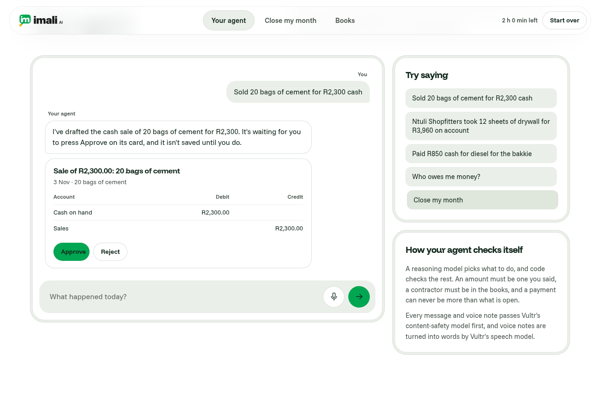

# Imali AI month-end agent

Imali AI runs the books, stock and sales of shops, suppliers and company groups. This repository is its month-end agent for a building-supply merchant. A shop owner usually closes the month by ticking each bank line against invoices, bills and the day's takings by hand; this agent does that matching and leaves the owner only the lines that need a decision. The owner tells their agent what happened by text or voice note, and the agent drafts each record. At the month's end it reads the bank statement, matches every line to the books, flags what does not fit, lists who owes money with follow-ups to copy, and posts what the owner approves to balanced double-entry books.

On the shop's October statement of 33 lines, the live copy closes the month in about half a minute. It matches 10 lines to invoices, bills and cash-ups, suggests an account for 16 costs and leaves 7 for the owner, and once all 33 lines are approved and posted, the bank balance in the books equals the statement's closing balance of R126,662.02.

It was built for Challenge 2 of Vultr: Agent Rush, "Powering the Future of Work", and this page is written for the event's judges and for developers who want to run it. The live copy runs on one Vultr VM in Seoul at https://158-247-235-244.sslip.io. To try it, follow the three-minute walk in [DEMO.md](DEMO.md); to run or deploy it yourself, see Run it and Deploy on Vultr below.

## The five steps of "Close my month"

The close runs as a job on the server, and each step streams to the page as it happens.

1. Read the bank statement: the CSV is opened in a parser container that has no network. It checks that the running balance adds up on every line, and the safety model screens the wording before any other model reads it.
2. Match each line: code decides every match, and an invoice, bill or cash-up is chosen only when its amount and date fit. The Vultr models only order the candidates, so a payer's name settles which of two equal invoices was paid, and a cost's wording suggests its account.
3. Flag what needs the owner: duplicate payments, amounts that do not match an open invoice or the day's takings, and payments that fit nothing come first in the review.
4. List who owes: the agent works out what each contractor owes once the matched payments are posted, and drafts a follow-up for each late account for the owner to copy into their own chat. It sends nothing.
5. Post and summarise: the owner approves or rejects each item, alone or in groups. Approved items post to the ledger as balanced entries, and the page shows a one-page summary of the month with the bank balance checked against the statement.

## How it uses Vultr

| Vultr service | Model or plan | What it does here | Code |
|---|---|---|---|
| Cloud Compute | vc2-2c-4gb, Ubuntu 24.04, Seoul | Runs the whole stack in Docker Compose, with Caddy serving TLS | `deploy/` |
| Serverless Inference | whisper-large-v3-turbo | Turns a voice note of up to 30 seconds into text | `app/vultr.py` `transcribe` |
| Serverless Inference | qwen3-embedding-4b | Shortlists the five accounts closest to each payment's wording | `VultrRanker.shortlist` |
| Serverless Inference | bge-reranker-v2-m3 | Scores customers, suppliers and accounts against each statement line | `VultrRanker.scores` |
| Serverless Inference | nemotron-3.5-content-safety | Screens every chat message and the statement's wording before the agent reads it | `Vultr.screen` |

The agent's reasoning, its tool calls and the text it writes come from a chat model reached through `LLM_BASE_URL`, which can be any service that speaks OpenAI's chat format. Code checks every figure it proposes: an amount must appear in the owner's own words, and a follow-up or the month's summary paragraph may only name sums the books hold.

We measured the reranker on the shop's October statement. On the eight costs the tests check, the right account scored between 0.016 and 0.86 and every wrong one 0.0015 or less, so the matcher trusts its first choice only when that choice clears a small floor and scores at least five times the second. Those scores are kept in `tests/data/rerank-october.json`, and the tests replay them. If Vultr cannot be reached, a word-matching ranker takes over and the step stream says so.

## Architecture

The browser talks only to Caddy, the web server in front, which passes requests to the web app (FastAPI). The web app and a background worker share one Postgres database, which holds the books, the jobs, every proposal and the audit trail. When the owner presses Close my month, the web app saves a job and the database tells the worker at once (`LISTEN/NOTIFY`). The worker claims the job so that no second worker can run it (`FOR UPDATE SKIP LOCKED`) and writes each step as an event, and the page shows each event as soon as it is written (server-sent events). Uploaded statements and voice notes reach the parser container through a small folder held in memory. That container cannot reach the internet, cannot change its own files, has no special rights on the machine and runs as its own user, and it deletes each file once it has read it.

Each visitor gets their own copy of the shop's books for two hours, kept apart from every other copy by a signed cookie. Start over gives a fresh copy. Money is held in whole cents throughout, so no rounding creeps in, and the database itself refuses to save any journal entry whose debits and credits differ: it checks each entry as the change is saved (a deferred constraint trigger).

## Limits and safety

The site is public, so every route has a ceiling, and each one is a setting in `app/config.py`. One address may open 6 copies an hour and 20 a day and make 1,000 model calls a day. One copy may send 25 messages and 10 voice notes, run 4 closes and make 400 model calls. All visitors together get 4,000 model calls a day. The counters live in Postgres, so a restart does not reset them.

An upload is cut off as it arrives once it passes its size: 20 KB for a statement, 1 MB and 30 seconds for a voice note, and 8 KB for anything else. Only the site's own pages can change anything, because every change needs a header that other sites cannot add. Page scripts cannot read the visitor's cookie and other sites cannot send it (HttpOnly, Secure and SameSite=Strict), and error replies never repeat what was sent. Voice notes are deleted as soon as they are turned into words. Every page tells the browser to run only the site's own scripts, to refuse being framed by another site and to use HTTPS from then on; the full set of headers is in `app/main.py` and `deploy/Caddyfile`.

## Run it

You need Python 3.12, PostgreSQL 16 and ffmpeg. `make test` creates a virtual environment, starts a throwaway Postgres and runs the whole suite, including the ledger balance tests. `make run` and `make worker` start the web app and the worker on a local database named by `DATABASE_URL`.

| Setting | What it is |
|---|---|
| `DATABASE_URL` | The Postgres database |
| `SECRET_KEY` | Signs the visitor's cookie |
| `LLM_BASE_URL`, `LLM_API_KEY`, `LLM_MODEL` | The OpenAI-compatible chat endpoint for the agent's reasoning |
| `VULTR_INFERENCE_KEY` | The Vultr Serverless Inference key |
| `SANDBOX_DIR` | The folder shared with the parser container |
| `COPY_MINUTES` | How long a visitor's copy lasts (120) |

## Deploy on Vultr

1. Create a firewall group that allows TCP 80 and 443 and UDP 443 from anywhere, and TCP 22 from your own address only.
2. Deploy a Cloud Compute instance on Ubuntu 24.04 with your SSH key and that firewall group, and paste `deploy/cloud-init.yaml` into its user data, which runs on first boot. That first boot installs Docker, turns off password logins, opens the web ports in ufw and clones this repository to `/opt/imali-agent`.
3. Send the keys over SSH on standard input, so they never appear on a command line or in a log: `printf 'LLM_BASE_URL=%s\nLLM_API_KEY=%s\nLLM_MODEL=%s\nVULTR_INFERENCE_KEY=%s\n' "$LLM_BASE_URL" "$LLM_API_KEY" "$LLM_MODEL" "$VULTR_INFERENCE_KEY" | ssh root@<ip> bash /opt/imali-agent/deploy/setup-env.sh <ip-with-dashes>.sslip.io`. The script makes the database password and the cookie key on the server, writes `deploy/.env` and starts the stack. Caddy gets the certificate by itself.

## Pre-existing work

Everything in this repository was written during the event, except the Imali AI logo (`static/img/`), its colours and the Funnel Display and Funnel Sans fonts (`static/fonts/`), which come from Imali AI. The logo and colours belong to Ebenworks and are not covered by the MIT licence. The fonts are under the SIL Open Font License, in `static/fonts/Funnel-LICENSE.txt`.

## Licence

The code is under the MIT License, in [LICENSE](LICENSE). Imali AI is built by Ebenworks.
